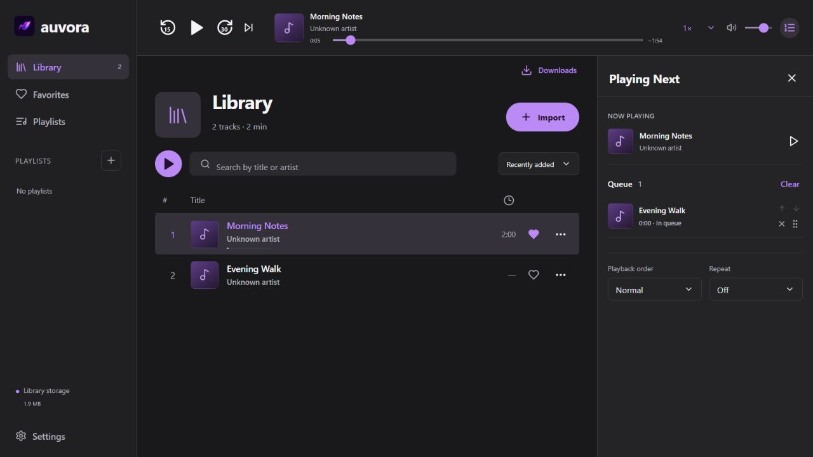

# auvora

auvora is an audio player for Windows 10/11 x64. It supports local audio files, playlists, playback queues and downloading audio from supported YouTube links. Stored audio can be played offline. Published by Soujin Productions.

The first public release is being prepared. See [known limitations](docs/limitations.md) for unfinished checks and known limitations.

[Light theme preview](docs/screenshots/library-light.jpg). Screenshots use synthetic audio in the browser preview; no personal library data is shown.

## Features

- Import local audio without moving the originals.
- Download audio from supported single-video YouTube links as MP3 or M4A.
- Create playlists and mark favorites.
- Use Play Next, Add to Queue and automatic collection continuation.
- Change playback order, repeat mode, speed and volume.
- Resume saved playback positions.
- Switch between light and dark themes.
- Export and restore library metadata as JSON.

## Installation

When a release is available, download `auvora_<version>_x64-setup.exe` and `SHA256SUMS.txt` from [GitHub Releases](https://github.com/zsoujin/auvora/releases). Verify the checksum, then run the installer. It includes the required audio tools and WebView2 installer; Node.js, Rust and Python are not required on the user's computer.

Current builds are unsigned and may trigger a Windows unknown-publisher warning. Read [installation and updates](docs/installation.md) before proceeding.

## Usage

1. Open auvora and select **Import**, or open **Downloads** and enter a supported video link.
2. Play a track or create a playlist from the sidebar.
3. Use a track's menu to mark it as a favorite, add it to a playlist or change the queue.
4. Open **Playing Next** to manage upcoming tracks.

See the [usage guide](docs/usage.md) and [troubleshooting](docs/troubleshooting.md). JSON backups contain metadata and local paths, not audio files. Keep a separate copy of your audio.

## Building from source

The application uses React, TypeScript, Tauri 2, Rust, SQLite and WebView2. Build on Windows with Node.js 24, Rust MSVC, Visual Studio C++ Build Tools and the Windows SDK. Follow [the build guide](docs/building.md) for pinned component preparation, checks and installer creation. See [architecture](docs/architecture.md) for the source layout and local storage.

## Contributing

Use the issue templates for bugs and feature proposals. Read [CONTRIBUTING.md](CONTRIBUTING.md), [CODE_OF_CONDUCT.md](CODE_OF_CONDUCT.md) and [SECURITY.md](SECURITY.md) before submitting a report or pull request.

## License

Application source and the owner-supplied logo are licensed under MIT, copyright Akniyet Manas. Dependencies and bundled executables retain their own licenses; see [LICENSE](LICENSE) and [THIRD_PARTY_NOTICES.md](THIRD_PARTY_NOTICES.md). Redistribution review of the installer remains a release gate.

Only download content you are authorized to download. Source availability and codec support vary. The summed 250 MB working-set target has not been met; clean-machine release acceptance remains pending.
